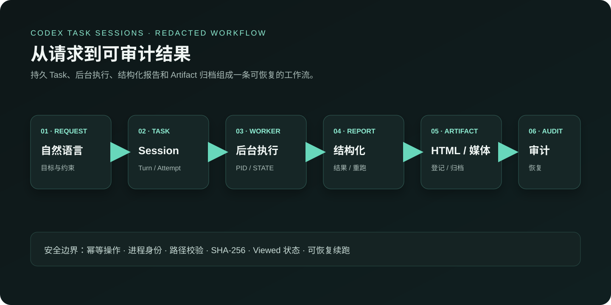
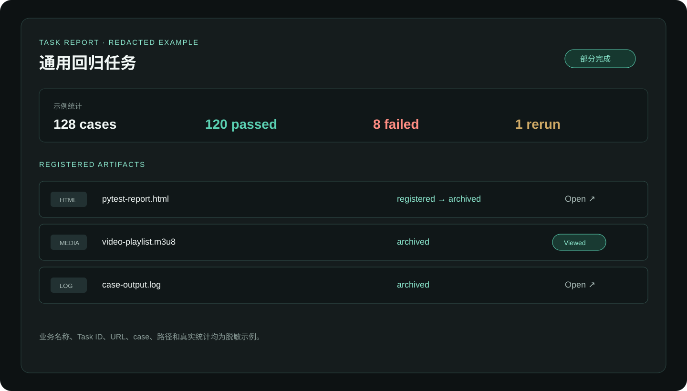

# Codex Task Sessions

Codex Task Sessions 是一个面向 Codex 执行任务的持久化工作台。它把一次自然语言请求从排队、执行、后台测试、报告生成、失败重跑到归档串成一条可追溯的 Task 生命周期。

## 作品定位

项目解决的是长时间、易中断、需要留证据的自动化工作流问题。每个 Task 拥有持久 Session，可以连续执行多个 Turn；后台命令通过 PID、LOG、DONE、STATE、META 登记，Worker 在 Codex 退出后继续观察，终态时恢复同一 Session 收集结果。

平台同时提供 Web 控制面和 HTTP API，覆盖任务生命周期、版本周期、Skills、运行库存、报告、审计、备份和恢复检查点。执行结果以结构化报告卡呈现，pytest HTML、日志、视频、音频和 Video Check 结果可以在运行中预览，并在终态后进入受校验的托管归档。

## 核心能力

- **持久 Task 生命周期**：支持 New、Run、Stop、Reset、Restore 和 Complete，保留 Turn、Attempt、命令、审计和 Transcript。
- **可靠后台执行**：记录进程身份和进程组，支持幂等启动、技术重试、任务级恢复和独立的 External Attempt。
- **业务报告闭环**：统一展示测试结果、部署结果、失败分析、工作流进度和自定义业务报告；同一 Run 可以关联多份 HTML 报告和失败分析文档。
- **媒体归档与播放**：托管 pytest HTML 引用的 HLS、DASH、FLV、MP4、音频、日志和 Video Check 资源；资源有路径边界、SHA-256 和 Range 访问校验。
- **运行库存管理**：区分 Runtime、Task 归档、报告、媒体、播放缓存和 Skill 快照，支持回收 Runtime 或删除非活动 Task。
- **安全与可恢复性**：SQLite WAL、在线备份、平台恢复检查点、30 天媒体保留策略、幂等操作和审计记录共同保证故障后的可恢复性。
- **中文优先的操作界面**：总览、任务详情、结构化报告、Codex CLI、Agent 记录、后台调度和操作审计集中在同一个工作台中，同时适配桌面和移动端。

## 页面与流程示意

作品截图采用脱敏的通用名称、统计和路径，只展示产品流程和交互结构。





## 验证结果

页面验证覆盖桌面端和移动端 viewport，确认了以下行为：

- 报告卡能够区分首轮、Rerun 和最终结果；
- HTML 登记项能够从运行中状态切换到终态 Artifact；
- 媒体资源能够展示已归档和 Viewed 状态；
- 模拟提交不会产生真实任务变更；
- 截图中的 Task、case、路径和业务统计均使用脱敏占位内容。

仓库质量门禁：

```bash
npm run check
npm test
npm run audit:production
```

架构、API、部署、数据恢复、报告和媒体生命周期分别见 [`docs/ARCHITECTURE.md`](ARCHITECTURE.md)、[`docs/API.md`](API.md)、[`docs/OPERATIONS.md`](OPERATIONS.md)、[`docs/DATA_AND_RECOVERY.md`](DATA_AND_RECOVERY.md)、[`docs/SKILL_REPORTS.md`](SKILL_REPORTS.md) 和 [`docs/MEDIA_RETENTION.md`](MEDIA_RETENTION.md)。
